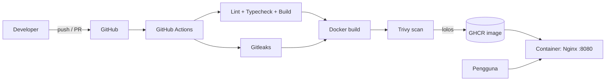

# 🎵 VibeLiners


Pemutar musik emotif yang mengubah seluruh tampilan ...

Pemutar musik emotif yang mengubah seluruh tampilan (warna, font, animasi) berdasarkan mood atau genre. Mood bisa ditulis bebas dan dianalisis oleh Gemini AI.

**Demo:** https://vibe-liners.vercel.app

> Repo ini juga berfungsi sebagai **portfolio DevOps**: aplikasi di-container-kan, di-build dan di-scan otomatis lewat CI/CD, lalu dipublikasikan sebagai image di GitHub Container Registry.

## Stack

| Lapisan   | Teknologi                                              |
| --------- | ------------------------------------------------------ |
| Aplikasi  | React, TypeScript, Vite, Tailwind CSS, Framer Motion   |
| AI        | Google Gemini                                          |
| Container | Docker (multi-stage), Nginx unprivileged               |
| CI/CD     | GitHub Actions                                         |
| Keamanan  | Trivy (image scan), Gitleaks (secret scan), Dependabot |
| Registry  | GitHub Container Registry (GHCR)                       |

## Arsitektur



## Pipeline CI/CD

1. **test**: `npm ci`, lint, `tsc --noEmit`, test, build.
2. **secret-scan**: Gitleaks memeriksa seluruh riwayat commit.
3. **docker**: build image, scan dengan Trivy (gagal jika ada CRITICAL/HIGH yang punya perbaikan), lalu push ke GHCR hanya pada branch `main`.
4. **Dependabot** membuat PR mingguan untuk npm, Docker, dan GitHub Actions.

## Menjalankan dengan Docker

```bash
cp .env.example .env        # isi GEMINI_API_KEY
docker compose up --build
# buka http://localhost:8080
```

Health check: `curl http://localhost:8080/health`

## Menjalankan tanpa Docker

```bash
npm ci
npm run dev
```

## Keputusan teknis

- **Multi-stage build**: image akhir hanya berisi Nginx dan file statis, tanpa Node.js dan source code, sehingga kecil dan permukaan serangannya sempit.
- **Non-root + read-only filesystem**: container berjalan sebagai user non-root, `cap_drop: ALL`, dan `no-new-privileges`.
- **Cache layer**: dependency di-install di stage terpisah agar build ulang cepat.
- **Catatan keamanan**: API key Gemini yang dipakai di frontend Vite tertanam di bundle. Rencana perbaikan: pindahkan panggilan Gemini ke backend proxy dan simpan key sebagai secret server.
- **Ukuran image**: ~76 MB (22 MB terkompresi), dibanding >1 GB jika Node.js dan source ikut terbawa.

## Roadmap

- [ ] Backend proxy untuk Gemini (secret tidak lagi di browser)
- [ ] Infrastructure as Code (Terraform) untuk deploy ke Cloud Run / ECS
- [ ] Monitoring (Prometheus + Grafana atau uptime check)
- [ ] Deploy otomatis (CD) dari image GHCR
- [ ] Kubernetes + ArgoCD (opsional)
